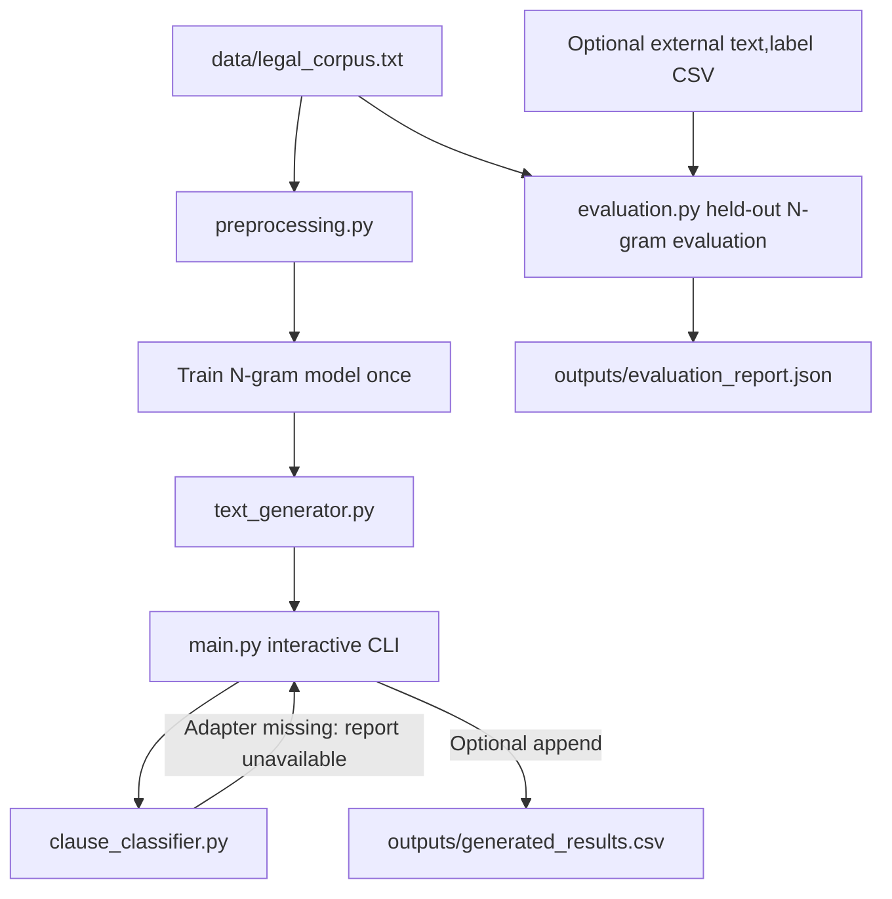

# Legal Drafting Assistant

A Python command-line prototype for generating legal-style sentences with
N-gram language models and evaluating language-model behavior. A GPT-2 clause
classifier integration is scaffolded, but classification is intentionally
unavailable until the course-provided adapter and label mapping are supplied.

> This is an educational drafting aid, not legal advice. Generated language
> requires review by a qualified professional.

## Problem and objectives

Legal drafting can involve repetitive clauses with recognizable wording and
structure. This project demonstrates a small, inspectable text-generation
workflow while keeping classification claims grounded in real model artifacts.
Its objectives are to:

- prepare a legal text corpus consistently;
- train and reuse unigram, bigram, and trigram models;
- generate legal-style text without exposing internal boundary/unknown tokens;
- evaluate language models on sentences excluded from training; and
- provide a clear integration point for a real, fine-tuned clause classifier.

## Features and status

| Feature | Status |
| --- | --- |
| UTF-8 corpus loading, text cleaning, and tokenization | Implemented |
| N-gram training with `<START>`, `<END>`, `<UNK>`, and add-alpha smoothing | Implemented |
| Interactive sentence generation and multi-sentence generation | Implemented |
| Reuse of the trained N-gram generator during a CLI session | Implemented |
| Held-out perplexity and next-token accuracy for unigram/bigram/trigram models | Implemented |
| CSV append for generated sentences and any actual classifier output | Implemented |
| GPT-2 fine-tuned clause classification | Pending adapter artifacts |
| Classification evaluation on held-out labeled data | Implemented as an API; pending classifier and labeled test CSV |
| ROUGE text-generation evaluation | Not implemented |

No adapter, classifier label mapping, or labeled test dataset is included.
Classification is reported as unavailable; no predictions or classification
metrics are fabricated.

## Technology

- Python 3.12
- scikit-learn for reproducible sentence splitting and classification metrics
- Python standard library for the CLI, file handling, JSON/CSV, and unit tests

Only the verified direct dependency is listed in `requirements.txt`.

## Repository layout

```text
.
├── .gitignore
├── README.md
├── requirements.txt
├── main.py
├── data/
│   ├── .gitkeep
│   └── legal_corpus.txt
├── models/
│   └── .gitkeep
├── outputs/
│   ├── .gitkeep
│   └── evaluation_report.json
├── src/
│   ├── __init__.py
│   ├── clause_classifier.py
│   ├── evaluation.py
│   ├── ngram_model.py
│   ├── preprocessing.py
│   └── text_generator.py
└── tests/
    ├── test_cli.py
    ├── test_evaluation.py
    ├── test_ngram_model.py
    ├── test_preprocessing.py
    └── test_text_generator.py
```

`venv/`, Python caches, IDE configuration, large model-weight files, and
`outputs/generated_results.csv` are ignored by Git. The legal corpus and
evaluation report remain included.

## Architecture and data flow



At startup the CLI preprocesses the corpus and trains one trigram model for
generation with `min_frequency=1`, retaining legal-specific singleton terms
instead of collapsing them to `<UNK>`. The `LegalClauseClassifier` is
initialized once; it currently checks for the required adapter artifacts and
fails clearly when they are absent. Evaluation trains separate unigram,
bigram, and trigram models on the training portion of the corpus, then scores
only the held-out portion using its existing default vocabulary threshold.

## N-gram generation

An N-gram model estimates the next token from the preceding `n - 1` tokens.
For example, the corpus includes:

> “The Client must pay each undisputed invoice within twenty days after
> receiving it.”

A bigram conditions on one preceding token; a trigram conditions on two.
Add-alpha smoothing gives every prediction-vocabulary token a nonzero
probability, including when a context was not observed. The prediction
vocabulary contains `<UNK>` and `<END>`, but not `<START>`. Low-frequency and
out-of-vocabulary words map to `<UNK>`. Generation filters `<START>`,
`<END>`, and `<UNK>` so internal markers do not appear in displayed text.
Add-alpha smoothing can assign equal scores to all tokens for an unseen
context; generation therefore checks observed transitions, backs off to
shorter observed contexts when needed, and prefers word tokens on exact ties.
This backoff and its repetition guards are confined to generation; model
training, probability estimates, and held-out evaluation are unchanged.
Generation searches multiple probability-ranked continuations, favors
observed trigram paths, uses corpus sentence-start evidence when a seed matches
a training clause opening, avoids repeated words and token pairs, and returns
only completed sentence paths ending with `.`, `?`, or `!`. If the seed is too
sparse to complete from the model, it returns an empty result rather than
presenting the seed itself as a generated clause. These constraints improve
local consistency but do not guarantee grammatical or legally correct text.

N-gram output is a statistical demonstration, not legal advice or a guarantee
of grammatical or legally valid text.

## GPT-2 classifier integration (pending)

GPT-2 is an autoregressive Transformer that tokenizes text into model token
IDs and predicts token distributions using learned attention over context.
Fine-tuning adapts pretrained parameters to a task such as clause-category
classification. PEFT (parameter-efficient fine-tuning) can store a small
adapter alongside the unchanged base model instead of distributing a complete
copy of all model weights.

When artifacts are provided, classification should load the exact GPT-2 base
model named by the adapter configuration, load the trained PEFT adapter, and
use its `id2label` mapping to translate predicted class IDs to the real clause
labels. Inference tokenizes the input, obtains class scores, and converts
scores to probabilities. A returned confidence is the classifier's probability
for its predicted class; it is not necessarily a calibrated measure of
correctness.

The required files/configuration are currently absent:

- `models/legal_clause_adapter/adapter_config.json`, including
  `base_model_name_or_path` (the exact base model ID);
- `models/legal_clause_adapter/adapter_model.safetensors` or
  `adapter_model.bin`; and
- `models/legal_clause_adapter/config.json` with the trained `id2label` map.

The optional classification evaluation dataset is also absent. Supply a
separate held-out CSV, defaulting to `data/classifier_test.csv`, with `text`
and `label` columns. The externally trained classifier must never have seen
those test examples. No dataset split can train a classifier that has not been
trained.

## Windows PowerShell setup

From the project directory:

```powershell
py -3.12 -m venv venv
.\venv\Scripts\Activate.ps1
python -m pip install -r requirements.txt
python main.py
```

The CLI accepts optional paths:

```powershell
python main.py --corpus data\legal_corpus.txt `
  --results outputs\generated_results.csv `
  --evaluation-data data\classifier_test.csv
```

If PowerShell prevents environment activation, use the venv interpreter
directly, for example:

```powershell
.\venv\Scripts\python.exe -m unittest discover -s tests -v
```

## CLI menu

1. **Generate and classify a legal sentence** — provide an optional seed or
   context, maximum generated-token count, and top-N candidate count.
2. **Generate multiple legal sentences** — choose a count and generation
   options; each sentence is classified only if the real classifier is
   available.
3. **Classify a custom legal sentence** — returns an actual classifier result
   only when its adapter is installed and loads successfully.
4. **Evaluate models** — evaluates N-gram models and, when both required inputs
   are available, the classifier.
5. **Exit**.

The CLI validates menu and numeric input. Generation continues if adapter
loading fails. When asked, results can be appended (never replacing existing
rows) to the CSV with `sentence`, `predicted_category`, `confidence`, and
`timestamp` columns. If classification is unavailable, the category and
confidence cells are left blank.

## Evaluation methodology and current results

N-gram evaluation uses a reproducible, sentence-level 80/20 split with
`random_state=42`. The 104 corpus sentences are split into 83 training and 21
test sentences. Models are trained only on the 83 training sentences; all 374
held-out target tokens, including sentence-ending `<END>` markers, are scored.
For a held-out sequence the perplexity is:

```text
PP = exp(-sum(log(P(target | context))) / number_of_held_out_targets)
```

Perplexity measures how well a language model assigns probability to
held-out tokens; lower is better. Next-token accuracy is the fraction of
held-out targets matching the model's top-ranked token. These are language
model metrics, not classification metrics.

The latest evaluation is saved in `outputs/evaluation_report.json`:

| Model | Held-out tokens | Perplexity (lower is better) | Next-token accuracy |
| --- | ---: | ---: | ---: |
| Unigram | 374 | 33.6149 | 0.3476 |
| Bigram | 374 | 41.0829 | 0.4118 |
| Trigram | 374 | 90.5714 | 0.2701 |

These results describe only this corpus and split. Classification accuracy,
precision, recall, F1, confusion matrix, and classification report are not
available until both a real adapter and labeled held-out CSV are supplied.
Accuracy is the share of predictions that match labels. Precision measures
how many predictions for a class are correct; recall measures how many true
examples of a class are found; F1 is their harmonic mean. Macro averaging
weights each class equally, while weighted averaging accounts for each class's
support. A confusion matrix counts true versus predicted labels. A synthetic
classification fixture in the unit tests checks metric calculations only; it
is not model performance.

Generation and classification require different evaluation measures:
generation predicts token sequences and is assessed here with perplexity and
next-token accuracy, while classification assigns discrete categories and
requires ground-truth labels for classification metrics.

## Tests

Run the standard-library `unittest` suite in the active venv:

```powershell
python -m unittest discover -s tests -v
```

Compile the application and source modules:

```powershell
python -m py_compile main.py (Get-ChildItem .\src -Filter *.py | ForEach-Object { $_.FullName })
```

Tests cover preprocessing, N-gram counts and probability normalization,
unknown-token handling, held-out perplexity and deterministic splitting,
classifier metric calculations using an explicitly test-only fixture,
generation marker filtering, CLI degradation and invalid input, and CSV
append behavior.

## Limitations and future work

- No fine-tuned GPT-2 adapter, adapter weights, trained `id2label` mapping, or
  labeled classifier test set is available.
- Clause segmentation and ROUGE evaluation are not implemented.
- N-gram generation is intentionally simple and can produce incomplete or
  unsuitable text.
- Future work: add the course-provided adapter and held-out labels, implement
  and validate inference against their actual mapping, evaluate on more
  representative legal data, and add human review workflows.

## Author

Author: **Sourabh Naik**
