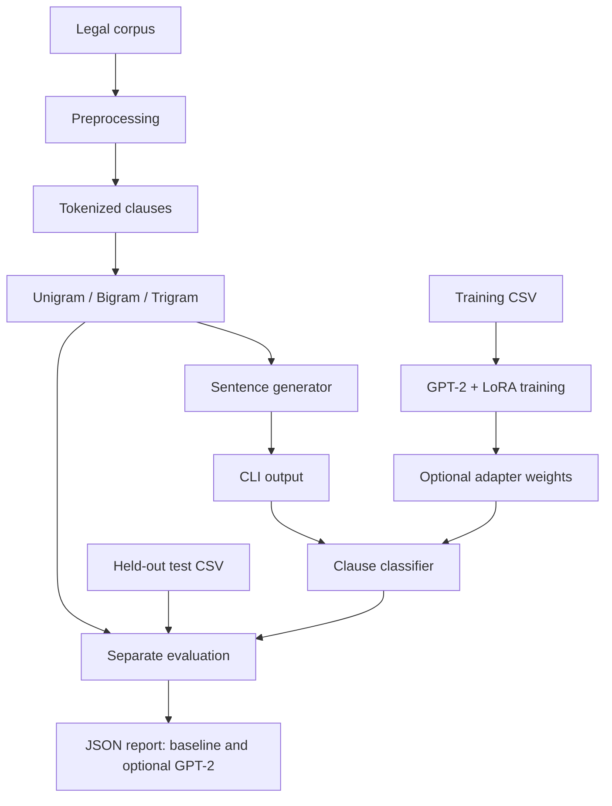

# Legal Drafting Assistant

[](https://ask.thili.ai/b/funp4b79ag)

An educational NLP project that prepares a small legal-style corpus, trains unigram/bigram/trigram language models, generates legal-style sentences, and classifies clauses into topic categories.

> **Disclaimer:** This is an educational demonstration, not legal advice or a substitute for review by a qualified legal professional. Generated text may be incomplete, inaccurate, or legally inappropriate.

## Project status

| Milestone | Status | Details |
| --- | --- | --- |
| 1. Legal corpus preparation | Complete | 104 example clauses; cleaning, sentence loading, tokenization and vocabulary utilities |
| 2. N-gram prediction and generation | Complete | From-scratch unigram, bigram and trigram models; MLE/add-alpha, `<UNK>`, generation and held-out scoring |
| 3. GPT-2 + LoRA clause classifier | Pipeline and Colab notebook complete; training pending | No adapter is shipped. Mark complete only after genuine training, saved weights, inference verification and held-out evaluation |
| 4. CLI integration | Complete | Hello, generation, next-word prediction, classification and held-out evaluation commands |
| 5. Evaluation | Complete for available models | N-gram and TF-IDF + Logistic Regression baseline results are separate; GPT-2 is explicitly marked not evaluated until trained |

When the GPT-2 adapter is absent or optional ML packages are unavailable, the
application uses a **TF-IDF + Logistic Regression baseline** and identifies it
as `tfidf-logreg baseline`. A loaded adapter is identified as `gpt2-lora`.
Corrupt adapter files produce a clear load error; baseline predictions are
never presented as GPT-2 output.

## Architecture



## Requirements

- Python 3.12 recommended
- Git (optional, for version control)
- Core workflow does not require an API key or a hosted LLM.
- GPT-2 training requires the optional packages and is intended for a GPU-backed
  Google Colab runtime; this repository does not include trained weights.

## Setup

### Windows PowerShell

```powershell
py -3.12 -m venv .venv
.\.venv\Scripts\Activate.ps1
python -m pip install --upgrade pip
python -m pip install -r requirements.txt
```

If PowerShell blocks activation, run this once in the current terminal:

```powershell
Set-ExecutionPolicy -Scope Process -ExecutionPolicy Bypass
.\.venv\Scripts\Activate.ps1
```

### macOS / Linux

```bash
python3.12 -m venv .venv
source .venv/bin/activate
python -m pip install --upgrade pip
python -m pip install -r requirements.txt
```

## Run the application

```bash
python -m app.cli hello
python -m app.cli generate --seed "the client" --count 3
python -m app.cli predict "the client" --n 3 --top-k 5
python -m app.cli classify "The supplier shall indemnify the customer against third-party claims."
python -m app.cli evaluate
```

Useful generation options:

- `--seed`: optional starting phrase
- `--count`: number of sentences (must be at least 1)
- `--max-length`: generation step limit (must be at least 1)
- `predict` accepts `--n 1`, `--n 2` or `--n 3` and reports the most likely
  next tokens and probabilities from the matching from-scratch model.

Generated text is a statistical continuation of a small corpus. It is not guaranteed to be grammatical, factually correct, or legally enforceable.

## Clause classification

### Baseline (available with core requirements)

The default fallback classifier is a TF-IDF vectorizer plus Logistic Regression trained on `data/classifier_train.csv`. It exists to make the CLI usable before the GPT-2 adapter is trained. Its output is clearly labeled as `tfidf-logreg baseline`.

### Optional GPT-2 + LoRA adapter

The GPT-2 adapter training workflow is provided separately because PyTorch and Transformers are large optional dependencies and training can require substantial compute.

The fallback is intentionally named `tfidf-logreg baseline`; it is not GPT-2.
Install the optional packages:

```bash
python -m pip install -r requirements-ml.txt
```

For the recommended GPU workflow, open
[`notebooks/train_gpt2_lora_colab.ipynb`](./notebooks/train_gpt2_lora_colab.ipynb)
in Google Colab, select a GPU runtime, then upload the clean project ZIP or
provide a repository URL in the notebook. The notebook checks GPU availability,
mounts Drive (optional), loads and validates the train/test schemas, trains only
on the training CSV, saves/downloads the adapter, reloads it, tests a sample,
and evaluates/saves the separate held-out comparison.

The equivalent local command (CPU or CUDA where configured) is:

```bash
python scripts/train_gpt2_adapter.py
```

The script uses `AutoModelForSequenceClassification` for `gpt2`, applies LoRA
to GPT-2 `c_attn`, and saves the `score` classification head with the adapter.
The adapter, tokenizer, model config, label mapping, training config and
training metadata are written to `models/legal_clause_adapter/`. It trains only from
`data/classifier_train.csv`; `data/classifier_test.csv` is strictly held out.
The training script performs a saved-adapter inference check before returning.
Do not claim GPT-2 results until the training command completes and the adapter
is present.

The adapter directory contains PEFT adapter weights/config, `config.json`,
GPT-2 tokenizer files, `label_mapping.json`, `training_config.json`, and
`training_metadata.json` (including the training CSV hash, row/class counts,
seed, device, epoch losses, and package versions). Classification prints
`[gpt2-lora]` when this adapter is active and `[tfidf-logreg baseline]` when the
fallback is active.

After training, run:

```bash
python -m app.cli classify "The supplier shall indemnify the customer against third-party claims."
python -m app.cli evaluate
```

The base GPT-2 checkpoint must be downloaded by Transformers when training/loading for the first time. Adapter weights are excluded from Git because they can be large. Do not claim GPT-2 results until training and inference have completed successfully.

## Evaluation

Run:

```bash
python -m app.cli evaluate
```

The command evaluates:
- From-scratch unigram, bigram and trigram models on a reproducible
  sentence-level 80/20 split (`random_state=42`), reporting perplexity and
  next-token accuracy.
- TF-IDF + Logistic Regression and, only when trained adapter files are
  available, GPT-2 + LoRA separately on the same held-out
  `data/classifier_test.csv`. Each evaluated classifier has accuracy,
  macro/weighted precision, recall and F1, classification report, confusion
  matrix, test size, and model name.

The report is saved to `outputs/evaluation_report.json`. If no trained adapter
is available, the GPT-2 entry has `status: "not_evaluated"` and a reason; no
baseline metrics are copied or relabeled as GPT-2.

### Current measured results

These results were reproduced with the core dependencies in this package:

| Model | Metric | Result |
| --- | --- | ---: |
| Unigram | Perplexity | 33.6149 |
| Unigram | Next-token accuracy | 34.76% |
| Bigram | Perplexity | 41.0829 |
| Bigram | Next-token accuracy | 41.18% |
| Trigram | Perplexity | 90.5714 |
| Trigram | Next-token accuracy | 27.01% |
| TF-IDF + Logistic Regression baseline | Held-out accuracy (24 clauses) | 41.67% |

The baseline's measured macro precision, recall and F1 are 48.75%, 41.67%
and 39.23%, respectively. The classification test set contains 24 examples
(three per each of eight labels). GPT-2 + LoRA has **no result yet** because
the adapter has not been trained in this environment. These are small
educational datasets; results should not be generalized to real legal
documents. The current report contains the actual N-gram and baseline metrics
and records GPT-2 as not evaluated.

## Tests

Install core requirements, then run:

```bash
python -m compileall -q app tests scripts
python -m pytest -v
```

The GitHub Actions workflow runs the core pytest suite on Python 3.12. It does not download GPT-2 weights or require secrets.

## Repository layout

```text
legal-drafting-assistant/
├── .github/workflows/ci.yml
├── app/
│   ├── cli.py
│   ├── core.py
│   ├── evaluation.py
│   ├── ngram_model.py
│   ├── text_generator.py
│   ├── preprocessing.py
│   ├── clause_classifier.py
│   ├── llm.py
│   └── storage.py
├── data/
│   ├── legal_corpus.txt
│   ├── classifier_train.csv
│   └── classifier_test.csv
├── models/                 # trained adapter is local and git-ignored
├── outputs/
├── scripts/train_gpt2_adapter.py
├── notebooks/train_gpt2_lora_colab.ipynb
├── tests/
├── requirements.txt
└── requirements-ml.txt
```

## Security and data handling

- Copy `.env.example` to `.env` only if you need local settings.
- Never commit `.env`, API keys, tokens, or credentials.
- Model adapter weights and per-run generated output are git-ignored.
- Raw Hugging Face caches, virtual environments, and temporary files are
  excluded from the clean ZIP package.
- The sample corpus and classifier CSVs are synthetic educational examples.

## Limitations and future work

- The corpus and labeled dataset are small and synthetic.
- N-gram generation can produce awkward or semantically inconsistent text.
- No trained GPT-2 adapter weights are distributed. The current development
  machine has an AMD Radeon iGPU and no NVIDIA CUDA GPU; use the Colab notebook
  for GPU training. Milestone 3 remains pending until that training succeeds.
- Sentence segmentation is heuristic and may need legal-document-specific rules.
- Future work includes expanding reviewed training data, completing and
  independently validating GPU training, and adding human-in-the-loop review.
