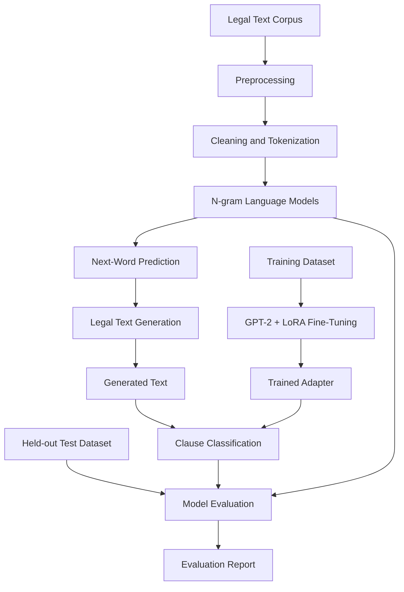

# Legal Drafting Assistant

[](https://ask.thili.ai/b/funp4b79ag)

An educational NLP project that generates legal-style text using from-scratch N-gram language models and classifies legal clauses using a fine-tuned GPT-2 model with LoRA (Low-Rank Adaptation).

> **Disclaimer:** This is an educational demonstration, not legal advice or a substitute for review by a qualified legal professional. Generated text may be incomplete, inaccurate, or legally inappropriate.

---

## Project Overview

The Legal Drafting Assistant implements five major milestones:

| Milestone | Description | Status |
|---|---|---|
| 1 | Prepare and preprocess a legal text corpus | Complete |
| 2 | Implement unigram, bigram and trigram next-word prediction from scratch | Complete |
| 3 | Fine-tune GPT-2 using LoRA for legal clause classification | Complete |
| 4 | Integrate text generation and clause classification through a CLI | Complete |
| 5 | Evaluate language models and classification models using held-out data | Complete |

## Features

- Legal corpus loading, cleaning, sentence segmentation and tokenization.
- From-scratch unigram, bigram and trigram language models.
- Maximum Likelihood Estimation (MLE) and add-alpha smoothing.
- Unknown-token (`<UNK>`) handling.
- Next-word prediction with top-k probabilities.
- Legal-style sentence generation.
- GPT-2 sequence classification with LoRA fine-tuning.
- Eight-category legal clause classification.
- TF-IDF + Logistic Regression baseline for comparison.
- CLI commands for generation, prediction, classification and evaluation.
- Evaluation reports containing accuracy, precision, recall, F1-score and confusion matrices.
- Automated tests and GitHub Actions CI workflow.

## Architecture



## Technologies Used

- **Programming language:** Python 3.12
- **Natural Language Processing:** Custom text preprocessing and N-gram models
- **Language model:** GPT-2
- **Fine-tuning:** LoRA using PEFT
- **Machine learning:** Scikit-learn, TF-IDF and Logistic Regression
- **Deep learning:** PyTorch
- **Model library:** Hugging Face Transformers
- **Testing:** Pytest
- **Development environment:** VS Code and Google Colab
- **Version control:** Git and GitHub
- **GPU training:** Google Colab Tesla T4

## Project Structure

```text
Legal-Drafting-Assistant/
│
├── .github/
│   └── workflows/
│       └── ci.yml
│
├── app/
│   ├── __init__.py
│   ├── clause_classifier.py
│   ├── cli.py
│   ├── core.py
│   ├── evaluation.py
│   ├── llm.py
│   ├── ngram_model.py
│   ├── preprocessing.py
│   ├── storage.py
│   └── text_generator.py
│
├── data/
│   ├── legal_corpus.txt
│   ├── classifier_train.csv
│   └── classifier_test.csv
│
├── models/
│   └── legal_clause_adapter/
│       ├── adapter_config.json
│       ├── adapter_model.safetensors
│       ├── config.json
│       ├── label_mapping.json
│       ├── tokenizer.json
│       ├── tokenizer_config.json
│       ├── vocab.json
│       ├── merges.txt
│       ├── special_tokens_map.json
│       ├── training_config.json
│       ├── training_metadata.json
│       └── README.md
│
├── notebooks/
│   └── train_gpt2_lora_colab.ipynb
│
├── outputs/
│   └── evaluation_report.json
│
├── scripts/
│   └── train_gpt2_adapter.py
│
├── src/
│   ├── clause_classifier.py
│   ├── evaluation.py
│   ├── ngram_model.py
│   ├── preprocessing.py
│   └── text_generator.py
│
├── tests/
│
├── main.py
├── pytest.ini
├── requirements.txt
├── requirements-ml.txt
├── .env.example
└── README.md
```

The `app/` package provides the milestone-based CLI workflow. The `src/` modules and `main.py` are also retained in the repository.

## Installation and Setup

### Prerequisites

- Python 3.12
- Git
- Internet connection for downloading the pretrained GPT-2 base model when required.

### Windows PowerShell

Clone the repository:

```powershell
git clone https://github.com/NaikSaurabh-28/Legal-Drafting-Assistant.git

cd Legal-Drafting-Assistant
```

Create and activate a virtual environment:

```powershell
py -3.12 -m venv .venv

.\.venv\Scripts\Activate.ps1
```

If PowerShell blocks activation:

```powershell
Set-ExecutionPolicy -Scope Process -ExecutionPolicy Bypass

.\.venv\Scripts\Activate.ps1
```

Install core dependencies:

```powershell
python -m pip install --upgrade pip

python -m pip install -r requirements.txt
```

Install optional GPT-2 dependencies:

```powershell
python -m pip install -r requirements-ml.txt
```

The optional dependencies include PyTorch, Transformers and PEFT. A GPU is recommended for training; CPU inference may be slower.

## Running the Application

The application provides the following CLI commands.

### 1. Check application status

```bash
python -m app.cli hello
```

### 2. Generate legal-style text

```bash
python -m app.cli generate --seed "the client" --count 3
```

### 3. Predict the next word

```bash
python -m app.cli predict "the client" --n 3 --top-k 5
```

The `--n` option selects the language model:

- `--n 1`: Unigram
- `--n 2`: Bigram
- `--n 3`: Trigram

### 4. Classify a legal clause

```bash
python -m app.cli classify "The supplier shall indemnify the customer against third-party claims."
```

When the trained adapter is available and successfully loaded, the classifier uses GPT-2 + LoRA. Otherwise, the application can use the TF-IDF + Logistic Regression baseline.

The output identifies the active classifier backend.

### 5. Evaluate the models

```bash
python -m app.cli evaluate
```

The evaluation report is saved to:

```text
outputs/evaluation_report.json
```

## GPT-2 Fine-Tuning Using LoRA

The project uses pretrained GPT-2 as the base language model and applies Low-Rank Adaptation (LoRA) for legal clause classification.

### Training workflow

1. Load the legal clause training dataset.
2. Load the pretrained GPT-2 model and tokenizer.
3. Prepare the eight classification labels.
4. Apply LoRA to the GPT-2 attention projection module.
5. Fine-tune the model using the training dataset.
6. Save the adapter weights, tokenizer and configuration.
7. Reload the saved adapter.
8. Verify inference using a sample legal clause.
9. Evaluate the classifier on a separate held-out test dataset.

### Training configuration

| Parameter | Value |
|---|---:|
| Base model | GPT-2 |
| Training samples | 80 |
| Number of classes | 8 |
| Samples per class | 10 |
| Epochs | 15 |
| Learning rate | 0.0003 |
| Batch size | 8 |
| Maximum sequence length | 128 |
| LoRA rank (r) | 8 |
| LoRA alpha | 16 |
| LoRA dropout | 0.1 |
| Random seed | 42 |
| Training device | NVIDIA Tesla T4 (Google Colab) |

The trained adapter and its configuration are included in:

```text
models/legal_clause_adapter/
```

### Reproducing training

The notebook is available at:

```text
notebooks/train_gpt2_lora_colab.ipynb
```

It can be opened in Google Colab using a GPU runtime.

Alternatively, run the training script:

```bash
python scripts/train_gpt2_adapter.py
```

Training requires the optional machine-learning dependencies and access to the pretrained GPT-2 checkpoint.

## Legal Clause Categories

The classifier predicts one of the following eight categories:

1. Payment
2. Confidentiality
3. Termination
4. Liability
5. Governing Law
6. Obligations
7. Indemnification
8. Dispute Resolution

Example:

**Input:**

```text
The supplier shall indemnify the customer
against third-party claims.
```

**Example prediction:**

```text
Predicted Category: indemnification
Confidence: 0.8883
```

The confidence value is an example from a verified inference run, not a guarantee of prediction reliability.

## Model Evaluation

The project evaluates the N-gram models and classification models separately.

### 1. N-gram Language Model Results

The N-gram models were evaluated using a reproducible sentence-level 80/20 train-test split with random state 42.

| Model | Perplexity | Next-token Accuracy |
|---|---:|---:|
| Unigram | 33.6149 | 34.76% |
| Bigram | 41.0829 | 41.18% |
| Trigram | 90.5714 | 27.01% |

### 2. Classification Results

The classification models were evaluated on a separate held-out test dataset containing 24 clauses, with three examples per class.

| Metric | TF-IDF Baseline | GPT-2 + LoRA |
|---|---:|---:|
| Accuracy | 41.67% | 50.00% |
| Macro Precision | 48.75% | 56.40% |
| Macro Recall | 41.67% | 50.00% |
| Macro F1-score | 39.23% | 48.99% |
| Test samples | 24 | 24 |

### Evaluation observations

- GPT-2 + LoRA achieved 50% accuracy on the held-out test set.
- The TF-IDF + Logistic Regression baseline achieved 41.67% accuracy.
- GPT-2 + LoRA improved accuracy by approximately 8.33 percentage points.
- The results demonstrate the implementation and evaluation of the fine-tuned classifier.
- The small dataset limits the reliability and generalizability of the measured results.

**Important:** These results are from the completed Colab evaluation run. Re-run `python -m app.cli evaluate` with the adapter and optional dependencies available to regenerate the local evaluation report.

## Testing

The project includes automated tests for preprocessing, N-gram models, text generation, classification, CLI functionality and evaluation.

Run the test suite:

```bash
python -m pytest -v
```

Run Python compilation checks:

```bash
python -m compileall -q app tests scripts
```

The GitHub Actions workflow runs the core test suite using Python 3.12.

## Limitations and Future Improvements

- The training corpus and labeled classification dataset are small educational datasets.
- N-gram generation may produce grammatically awkward or semantically inconsistent sentences.
- GPT-2 classification accuracy is limited by the size and diversity of the training data.
- The model's predictions should not be treated as legal conclusions.
- Generated legal text requires human review before any practical use.

Possible future improvements:

- Expand the legal corpus using reviewed legal documents.
- Increase the number of labeled training examples.
- Evaluate on larger and more diverse external datasets.
- Experiment with other pretrained language models.
- Improve generation quality and contextual consistency.
- Introduce human-in-the-loop review and feedback.

## Security and Data Handling

- Never commit API keys, passwords, tokens or other secrets.
- Keep real environment configuration in `.env`.
- `.env.example` provides a safe configuration template.
- The included training datasets are educational examples.
- Model files and generated outputs should be reviewed before sharing.

## Author

**Sourabh Naik**

GitHub: [NaikSaurabh-28](https://github.com/NaikSaurabh-28)

Project Repository: [Legal-Drafting-Assistant](https://github.com/NaikSaurabh-28/Legal-Drafting-Assistant)

---

*Developed as an educational NLP and machine-learning project for the askThili AI evaluation.*
